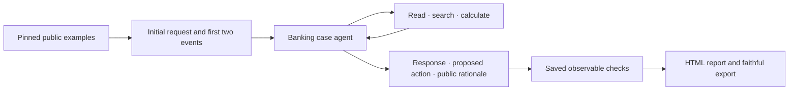

# dwelly-bot

A banking service case reviewer for the Dwelly AI Hackathon 2026, **Banking & Financial Services** track. It reads the evidence available at a decision point, produces a cited customer response and an operator action plan, and records missing information and the need for human review.

The operational problem is a gap between a customer's request and what bank records actually establish: authorisation, debit, sending and recipient credit are different states. The agent keeps that distinction explicit. It currently has read-only evidence tools; bank actions and customer messages are proposals, not executed effects.

## Install and run

Use Python 3.12 and [uv](https://docs.astral.sh/uv/getting-started/installation/) on macOS/Linux or WSL (local budget locking uses `fcntl`).

```sh
uv sync --locked --extra analysis
uv run python dataset/fetch.py
uv run dwelly-bot check
uv run dwelly-bot agent doctor
```

Copy `.env.example` to `.env` and supply `ANTHROPIC_API_KEY` for the configured agent. Never commit credentials. The offline checks, source analysis and saved-report rendering make no model calls.

```sh
# Paid execution; uses the cumulative account cap in the tracked configuration.
uv run dwelly-bot run dwelly-banking --config experiments/baseline/config.json
# Inspect saved baseline freshness without rerunning it.
uv run dwelly-bot experiment baseline check experiments/baseline/reference.json
# Offline analysis and local project overview.
uv run --extra analysis dwelly-bot analyze run dwelly_bot.analysis.banking --data dataset
uv run --extra analysis python -m dwelly_bot.reporting.site
```

[Dataset installation and provenance](dataset/README.md) · [Saved baseline and experiments](experiments/README.md) · [Analysis](analysis/README.md) · [Submission](SUBMISSION.md).

## Architecture



The adapter owns the case identity, evidence boundary and saved checks. The shared Pydantic AI harness owns tool permissions, limits and local journals. The model pool and process-safe budget ledger are shared by execution and optional analysis/judging. Reporting and analysis do not run the agent. No vendor telemetry, usage reports or session exporters are enabled.

## Models and external services

The baseline uses `claude-sonnet-5-5` through the Anthropic API, with low reasoning effort and prompt caching. Cost is an estimate using the configured input/output rates, not a provider invoice. Optional OpenRouter/OpenAI transports remain available. GitHub hosts the version-pinned source archive; no operational bank API or customer simulator is supplied or invented. Dependencies are locked in `uv.lock`.

Account ledgers live under ignored `.cache/accounts/`. Settled amounts and unresolved reservations carry forward across dataset changes. A configured cap is cumulative, not a fresh per-run allowance, and is local to this laptop. Existing caps never increase automatically. Copy the relevant ledger when moving paid work between environments; an empty ledger cannot prove remaining account credit.

## Data and assumptions

- The [organizer public examples](https://github.com/DwellyOrg/HackatonPublicCases) are development material. This project assigns all 50 banking cases, preserving IDs `001`–`050` as `banking-001`–`banking-050` so track-local numbers remain unambiguous.
- The development decision point is after event 002. The initial request and first two events are visible; outcome-revealing titles, status, summaries, later events and attachments are withheld. Attachment availability at that time is not established.
- Original bytes and the pinned ZIP remain in the ignored dataset. Models and source analysis only read derived visible views. Reinstall verifies hashes and refuses changed data.
- Public histories are examples, not trusted labels. Saved checks test answer presence, actual retrieval and whether cited lines were observed. They do **not** establish semantic correctness, safety or successful operations; outcome correctness remains unknown.
- Synthetic timestamps are case-local. Matching fictional names do not join separate cases.

## Known limitations

There is no live bank integration, outgoing messaging, confirmed handover, attachment processing at the chosen cutoff, or independent outcome grading. The adapter currently accepts the public development format only. Reality Test ingestion needs the released challenge format and must preserve its organizer IDs and supplied evidence without reading hidden evaluation material. Public development exports must not be submitted as Reality Test answers. A complete development run is not proof of readiness for unseen cases.

## Next steps

Validate response and action quality with reviewed examples; integrate only organizer-supplied operational tools and authority rules; support timestamped attachment availability; implement and validate the released challenge input contract before the code freeze. Keep all unseen Reality Test cases isolated from development and tuning.

## Development

Follow [AGENTS.md](AGENTS.md), the [repository sync workflow](.agents/skills/dwelly-bot-repo-sync/SKILL.md) and the [experiment workflow](.agents/skills/dwelly-bot-experiment/SKILL.md). Work on `main`; commit requested changes and push only when requested. The local history has a new event root; upstream history and hosted Pages require a separately authorized replacement. Do not merge the superseded upstream history into this root.

- `src/dwelly_bot/adapters/`: data mappings and guards; `harness/`, `context/`, `tools/`, `prompts/`, `skills/`: agent and tool boundaries.
- `experiments/`, `evaluation/`, `reporting/`: capture, saved checks and display. [Report components](src/dwelly_bot/reporting/README.md).
- `analysis/`: recipe usage; generated corpus-derived reports remain ignored. Coding skills live in `.agents/skills/`; `.claude/skills/` links to them.
- Quick edits: `uv run ruff check src tests experiments/controls dataset/fetch.py`, `uv run ruff format src tests experiments/controls dataset/fetch.py`, `uv run mypy`, and affected `uv run pytest -q tests/test_AREA.py`. `dwelly-bot check` runs the complete offline gate.

[Apache 2.0](LICENSE). The organizer source remains linked and versioned; its public availability does not imply a separate dataset licence. Original source archives are not committed.
