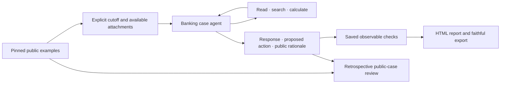

# dwelly-bot

[Live banking overview](https://xmanatee.github.io/dwelly-hack-2026/) · [Baseline report](https://xmanatee.github.io/dwelly-hack-2026/baseline.html)

**Architecture:** [Context → Planner → Execution](docs/architecture/README.md) · [Visual diagram](docs/architecture/index.html). An [offline production skeleton](examples/production/README.md) now connects email/call/ticket triggers, Markdown context, the public Planner (`text → Plan`) and mock execution. Planner currently always requests human review. Separate Hackathon Solver packaging and answer generation remain planned. The historical agent and benchmarks below predate this migration.

[Integration status and remaining work](docs/architecture/integration-status.md) · [Planner handoff for Vera](src/dwelly_bot/planning/implementation/README.md). Optional context-agent mode can investigate JSON/SQLite sources; action profiles and local calculation are implemented.

Run the new vertical slice without a model or external actions:

```sh
uv run dwelly-bot demo --input examples/production/ticket.json --records examples/production/records.json --output .cache/production-demo/ticket
```

Use a new output directory each time. Inspect `context.md`, `plan.json`, `result.json` and `events.jsonl` there. [Three-channel examples and extension interfaces](examples/production/README.md) describe the mock limits and how to connect real sources. Replying to the original channel is a plan action; there is no additional delivery stage.

**Historical benchmark:** [MiniMax M3 vs Sonnet 5.5](experiments/sonnet-vs-minimax-anthropic/README.md), 50/50 executed and reviewed per model. [Open the comparison](experiments/sonnet-vs-minimax-anthropic/comparison.html).

A banking service case reviewer for the Dwelly AI Hackathon 2026, **Banking & Financial Services** track. It reads the evidence available at a decision point, produces a cited customer response and an operator action plan, and records missing information and the need for human review.

The operational problem is a gap between a customer's request and what bank records actually establish: authorisation, debit, sending and recipient credit are different states. The agent keeps that distinction explicit. It currently has read-only evidence tools; bank actions and customer messages are proposals, not executed effects.

## Install and run

Use Python 3.12 and [uv](https://docs.astral.sh/uv/getting-started/installation/) on macOS/Linux or WSL (local budget locking uses `fcntl`).

```sh
uv sync --locked --extra analysis --extra evaluation
uv run python dataset/fetch.py
uv run python dataset/fetch.py --archive dataset/release.zip --profile configs/banking-development.json --root .cache/datasets/banking-reviewed
uv run dwelly-bot check
uv run dwelly-bot agent doctor
```

Copy `.env.example` to `.env` and supply `OPENROUTER_API_KEY` for the MiniMax control and `ANTHROPIC_API_KEY` for the Sonnet candidate and Opus judge. Never commit credentials. The offline checks, source analysis and saved-report rendering make no model calls.

```sh
# Paid execution; uses the cumulative account cap in the tracked configuration.
uv run dwelly-bot run dwelly-banking --dataset-root .cache/datasets/banking-reviewed --config experiments/minimax-baseline/config.json --experiment NEW_CONTROL_NAME
# Offline analysis of the corrected decision-time view.
uv run --extra analysis dwelly-bot analyze run dwelly_bot.analysis.banking --data .cache/datasets/banking-reviewed
# Compare historical baseline answers with later public evidence, without rerunning them.
uv run --extra analysis dwelly-bot analyze run dwelly_bot.analysis.banking_review --data dataset --run experiments/baseline/results.json.gz
# Local overview of saved results and the active baseline corpus.
uv run --extra analysis python -m dwelly_bot.reporting.site
```

[Dataset installation and provenance](dataset/README.md) · [Saved baseline and experiments](experiments/README.md) · [Analysis](analysis/README.md) · [Submission](SUBMISSION.md).

## Current implementation (before migration)



The adapter owns the case identity, evidence boundary and saved checks. The shared Pydantic AI harness owns tool permissions, limits and local journals. The model pool and process-safe budget ledger are shared by execution and optional analysis/judging. Reporting and analysis do not run the agent. No vendor telemetry, usage reports or session exporters are enabled.

## Models and external services

The current control uses `minimax/minimax-m3` through OpenRouter; the complete candidate uses `claude-sonnet-5-5` through Anthropic. Both use low reasoning effort and the same acting prompt, tools, limits and 50 corrected case inputs. The common retrospective judge uses `claude-opus-5-5` through Anthropic. OpenRouter costs are provider-reported; direct Anthropic costs use configured-rate estimates. The provider/caching difference is part of this comparison and limits model-only cost/latency conclusions. The incomplete OpenRouter Sonnet attempt is retained separately. GitHub hosts the version-pinned source archive; no operational bank API or customer simulator is supplied or invented. Dependencies are locked in `uv.lock`.

Account ledgers live under ignored `.cache/accounts/`. Settled amounts and unresolved reservations carry forward across dataset changes. A configured cap is cumulative, not a fresh per-run allowance, and is local to this laptop. Existing caps never increase automatically. For the explicitly authorized full comparison, both provider ledgers were raised to $100 while preserving earlier charges and unresolved reservations. Copy the relevant ledger when moving paid work between environments; an empty ledger cannot prove remaining account credit.

## Data and assumptions

- The [organizer public examples](https://github.com/DwellyOrg/HackatonPublicCases) are development material. This project assigns all 50 banking cases, preserving IDs `001`–`050` as `banking-001`–`banking-050` so track-local numbers remain unambiguous.
- The organizer asks developers to study complete cases, choose a decision point, expose only evidence available then, and compare decisions with later evidence. The recorded outcome is not the only acceptable decision. [Our data contract](dataset/README.md) separates those views.
- The historical baseline chose event 002 and excluded every attachment. The reviewed profile keeps that default with configurable per-case cutoffs and includes case 041's CSV, uploaded in event 001. Eight later attachments stay withheld. The new MiniMax control and Sonnet experiment use this corrected input. Historical v1 results and their reference remain preserved separately.
- Original bytes and the pinned ZIP remain in the ignored dataset. Acting models and the default analysis recipe read only visible views. An explicitly invoked retrospective recipe reads complete public cases and can display saved answers beside the reference evidence. Saved evaluation with `--public-reference` supplies verified full histories and attachments only to the judge; the evaluation profile hashes that exact reference payload. Reinstall verifies hashes and refuses changed data or profiles.
- Public histories are examples, not trusted labels. Saved checks test answer presence, actual retrieval and whether cited lines were observed. They do **not** establish semantic correctness, safety or successful operations; outcome correctness remains unknown.
- Synthetic timestamps are case-local. Matching fictional names do not join separate cases.

## Known limitations

There is no live bank integration, outgoing messaging, confirmed handover or independently observed operational outcome. Retrospective model reviews assess answer quality, with per-criterion reasons; they are not outcome ground truth. Available text attachments are supported; available PDF/image attachments cause an explicit unsupported-media error. The adapter accepts the public development format only. Reality Test ingestion needs the released challenge format and must preserve its organizer IDs and supplied evidence without reading hidden evaluation material. Public development exports are labelled as practice and blocked from the conventional `ANSWERS/` destination. A complete development run is not proof of readiness for unseen cases.

## Next steps

Review the recorded comparison before adopting a candidate; use its failures to propose the next agent experiment; implement decision-time PDF/image reading; integrate only supplied operational tools and authority rules; implement and validate the released challenge input contract before the code freeze. Keep all unseen Reality Test cases isolated from development and tuning.

## Development

Follow [AGENTS.md](AGENTS.md), the [repository sync workflow](.agents/skills/dwelly-bot-repo-sync/SKILL.md) and the [experiment workflow](.agents/skills/dwelly-bot-experiment/SKILL.md). Work on `main`; commit requested changes and push only when requested. GitHub `main` and Pages use the banking project history. Teammates with an older checkout should make a fresh clone and preserve any uncommitted work separately; do not merge unrelated histories.

- `src/dwelly_bot/adapters/`: data mappings and guards; `harness/`, `context/`, `tools/`, `prompts/`, `skills/`: agent and tool boundaries.
- `experiments/`, `evaluation/`, `reporting/`: capture, saved checks and display. [Report components](src/dwelly_bot/reporting/README.md).
- `analysis/`: recipe usage; generated corpus-derived reports remain ignored. Coding skills live in `.agents/skills/`; `.claude/skills/` links to them.
- Quick edits: `uv run ruff check src tests dataset/fetch.py`, `uv run ruff format src tests dataset/fetch.py`, `uv run mypy`, and affected `uv run pytest -q tests/test_AREA.py`. `dwelly-bot check` runs the complete offline gate.

[Apache 2.0](LICENSE). The organizer source remains linked and versioned; its public availability does not imply a separate dataset licence. Original source archives are not committed.
