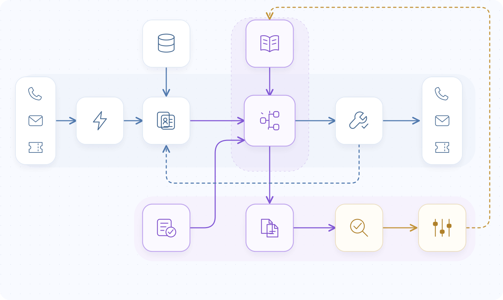
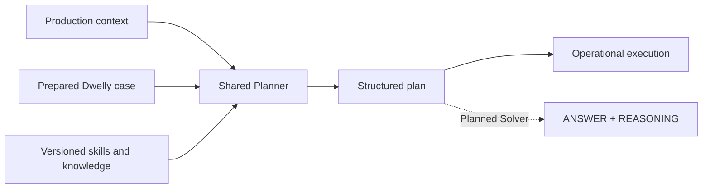

<div align="center">

# dwelly-bot

**Turn service context into a concrete next action.**

An open-source operational agent for requests that arrive as emails, calls and tickets.
Built for the **Dwelly AI Hackathon 2026 · Banking & Financial Services**.

[Quickstart](#quickstart) · [Architecture](docs/architecture/README.md) · [Planner](docs/planner/README.md) · [Evaluation](docs/evaluation/README.md) · [Demo](demo/README.md)

Python 3.12 · Pydantic AI · uv · [Apache 2.0](LICENSE)

</div>

## Context. Decision. Action.

A customer says a payment was sent. A record shows only a debit. A support agent needs to know what is established, what is missing and what can actually happen next.

Dwelly-bot separates that work into three components: **gather the evidence, decide the next move, execute the chosen actions**. The Planner is the decision-making core. It turns a prepared context into a strategy for the case: respond, act, ask for missing information or involve a person.

[](docs/architecture/index.html)

*Blue: the operational workflow. Purple: the shared Planner and contest path. Gold: evaluation and improvement. The shared-core diagram is the target design; the separate Solver package now exists, with Planner contract alignment still pending.*

[Interactive diagram source](docs/architecture/index.html) · [Component contracts](docs/architecture/README.md) · [Implementation status](docs/architecture/integration-status.md)

## One decision core, several ways in

| Stage | Responsibility | In this repository |
| --- | --- | --- |
| **Trigger** | Normalize email, call or ticket; preserve its reply route. | Typed inputs and local fixtures. |
| **Context** | Identify useful information and read authorized sources. | JSON/SQLite readers and synthetic-bank sources; optional Pydantic AI investigator. |
| **Planner** | Apply knowledge to the available facts; choose concrete actions. | Public `text → Plan` API and action profiles. Local runner uses a human-review stub; a separate [advisory Planner](src/dwelly_bot/planner/README.md) also exists. |
| **Execution** | Run the selected steps and record their results. | Mock communication/handoff/ticket actions; local arithmetic; durable mock receipts. |

Replying in the original channel is a plan action. The executor does not make a second business decision or silently send an extra response.

## Why the Planner matters

Gathering more data and choosing what to do are different problems. Once the context is ready, the Planner can concentrate on the hardest question: **what is the right next action, given these facts, rules and uncertainties?**

That boundary also makes the component independently testable. Production gathers the context; the hackathon adapter prepares supplied case evidence as text. Both are intended to call the same Planner.



**Design direction:** a multi-step reasoning component that selects relevant skills, checks candidate actions against evidence and emits a small executable plan. Hierarchical skill access and specialist sub-agents remain design options. The team has added an advisory case Planner with its own schema; the local executable-plan pipeline still uses its stub. [Planner design and Vera's TODOs](docs/planner/README.md).

## Quickstart

Requires **Python 3.12** and [uv](https://docs.astral.sh/uv/) on macOS, Linux or WSL. The default demo needs no API key or dataset download.

```sh
git clone https://github.com/xmanatee/dwelly-hack-2026.git
cd dwelly-hack-2026
uv sync --locked

uv run dwelly-bot demo \
  --input examples/production/ticket.json \
  --records examples/production/records.json \
  --output .cache/quickstart/ticket
```

The placeholder Planner requests human review and replies to the original ticket. Both external actions are explicitly **simulated**.

```text
.cache/quickstart/ticket/
├── input.json       # original event
├── trigger.json     # normalized route
├── context.md       # exact text sent to Planner
├── context.json     # source records and gaps
├── plan.json        # selected actions
├── result.json      # action receipts
└── events.jsonl     # local execution journal
```

Use a new output directory for each run; captures are preserved. [Try email, calls, calculation → reply and replay protection](examples/production/README.md).

```sh
# Inspect the exact JSON action schemas; no model calls.
uv run dwelly-bot actions --profile production
uv run dwelly-bot actions --profile contest
```

## Run the synthetic banking world

```sh
uv run --extra synthetic --extra evaluation \
  python local_testing/banking/build.py
uv run dwelly-bot local run --case SYN-0001 --output .cache/local-bank/quickstart
```

[Local testing guide](local_testing/banking/README.md): state/case separation, email and call
replays, model configuration and custom triggers. Add `--context-config
experiments/synthetic-context-integration/config.json` to enable the LLM collector.
The runtime uses reviewed decision-time responses; completed entity state and evaluator
answers remain separate. [Integration checks and saved runs](experiments/synthetic-context-integration/README.md).

## Improving decisions with synthetic cases

Our testing approach has two complementary paths:

| Path | What it tests | Status |
| --- | --- | --- |
| **Dwelly examples → prepared context → Planner → answer** | Decision quality on supplied operational cases. | Data adapter, advisory Planner and [Solver generation/export](src/hackathon_winner/README.md) exist; shared Planner contract alignment remains pending. |
| **Synthetic world → noisy events → context → plan → execution** | Missing facts, ambiguous identities, conflicting records and failed actions. | 1,180 generated banking cases; separate state/cases/evaluation data and a working local runner. |

The generator direction is reusable across service tracks; the current implemented dataset adapter is banking-specific. We keep future outcomes outside the acting context and evaluate saved decisions afterward. [Evaluation loops, scenario design and optimization TODOs](docs/evaluation/README.md).

**Existing evidence:** [MiniMax M3 vs Sonnet 5.5](experiments/sonnet-vs-minimax-anthropic/README.md) contains 50 executed and reviewed cases per model for the **earlier agent**. Those results are not a score for the new Planner. [Saved report site](https://xmanatee.github.io/dwelly-hack-2026/).

## Models, services and voice

| Component | Dependency or configuration |
| --- | --- |
| Agent runtime | Pydantic AI; locked dependencies in `uv.lock`. |
| Context investigator | Optional model via `--context-config`; shared provider pool, budget and journal. |
| Planner | Final model and skill hierarchy **TBD — Vera**; default stub makes no model calls. |
| Historical experiments | MiniMax M3 / OpenRouter; Sonnet 5.5 and Opus 5.5 judge / Anthropic. |
| Sources and execution | Local JSON/SQLite; communication adapters are mock. |
| Voice | Call-event contract exists. Speech provider, model and live transport **TBD**. |

For model-backed runs, copy `.env.example` to `.env` and set only the selected provider's key (`ANTHROPIC_API_KEY`, `OPENROUTER_API_KEY` or `OPENAI_API_KEY`). `--context-config` explicitly enables paid calls; offline demos, checks and saved-report rendering do not. No vendor telemetry or session capture is enabled. [Configuration and development](docs/development/README.md).

Voice will use the same context/planning/execution core. [Voice integration slots and diagram](docs/voice/README.md) · [Demo storyboard — video pending](demo/README.md).

## Assumptions and next steps

Source adapters establish access boundaries; names and email addresses remain search hints. A plan is intent, a mock receipt is a simulation, and neither proves an external bank operation occurred. Public examples are development data, not final Reality Test submissions.

Next: align the advisory Planner with the shared executable-plan contract and Solver, evaluate the combined decision core, add temporal entity snapshots and real channel/voice adapters. Live banking effects, final voice integration and a recorded demo are not implemented. [Detailed gaps and ownership](docs/architecture/integration-status.md).

## Explore and contribute

[Development & checks](docs/development/README.md) · [Data contract](dataset/README.md) · [Experiment workflow](experiments/README.md) · [Submission metadata](SUBMISSION.md) · [Project story](docs/story.md)

See [AGENTS.md](AGENTS.md) for repository conventions. [References and related work](docs/references.md) explain the design reading and implementation dependencies.

Licensed under [Apache 2.0](LICENSE). Third-party libraries and data retain their own terms; source archives and credentials are not committed.

## Run Hackathon Winner

```sh
uv run hackathon-winner /path/to/cases
uv run hackathon-winner /path/to/cases --output .cache/winner/evaluation-1
```

Default output: repository-root `ANSWERS/<original-case-folder>/ANSWER.md` and `REASONING.md`.
With no arguments, the command uses the two bundled synthetic smoke cases. Default model:
Anthropic Sonnet via `ANTHROPIC_API_KEY`; `--config` can select the saved Claude Code configuration.
The runner imports `dwelly_bot.planner`, includes supplied attachments, preserves model
failures, and saves context, plans and journals. [Setup, input contract and examples](src/hackathon_winner/README.md).
