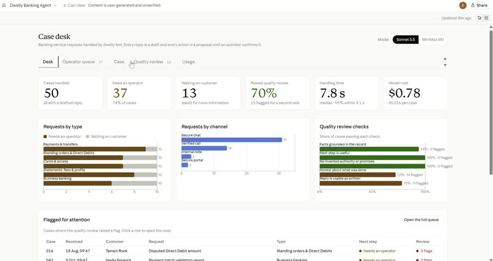
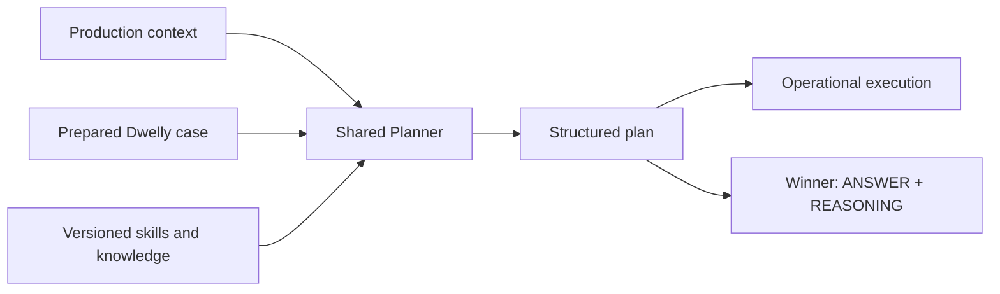

<div align="center">

# dwelly-bot

**Turn service context into a concrete next action.**

An open-source operational agent for requests that arrive as emails, calls and tickets.
Built for the **Dwelly AI Hackathon 2026 · Banking & Financial Services**.

[Quickstart](#quickstart) · [Architecture](docs/architecture/README.md) · [Planner](docs/planner/README.md) · [Evaluation](docs/evaluation/README.md) · [Demo](#watch-the-demo) · [Final answers](ANSWERS/README.md)

Python 3.12 · Pydantic AI · uv · [Apache 2.0](LICENSE)

</div>

## Watch the demo

[](demo/dashboard.mp4)

**[▶ Main product demo](demo/dashboard.mp4)** · **[▶ Voice call demo](demo/voice-call.mp4)**

The case desk shows requests, decisions and operator review. The ElevenLabs voice integration
lets a caller ask about a case and hear the pipeline's response in the same conversation.
The recorded voice scenario uses a prepared demo plan; external banking actions remain simulated.
[Live demo: 2–3 minute runbook](demo/LIVE-DEMO.md) · [Voice setup](examples/voice/README.md) · [Video details](demo/README.md).

**Reality Test:** all **30 Banking & Financial Services challenges** have generated
[answers and reasoning](ANSWERS/README.md), with plans, evidence references and local traces.
Opus 5.5 at high effort completed all cases with **zero generation failures**,
preserving the proposed actions, explanations and evidence for review.
[Run report](ANSWERS/report.html) · [Verification](ANSWERS/verification.json).

## Context. Decision. Action.

A customer says a payment was sent. A record shows only a debit. A support agent needs to know what is established, what is missing and what can actually happen next.

Dwelly-bot separates that work into three components: **gather the evidence, decide the next move, execute the chosen actions**. The Planner is the decision-making core. It turns a prepared context into a strategy for the case: respond, act, ask for missing information or involve a person.

[](docs/architecture/index.html)

*Blue: the operational workflow. Purple: the shared Planner and contest path. Gold: evaluation and improvement. Both product and Winner now call the same Planner; external actions remain explicitly simulated.*

[Interactive diagram source](docs/architecture/index.html) · [Component contracts](docs/architecture/README.md) · [Implementation status](docs/architecture/integration-status.md)

## One decision core, several ways in

| Stage | Responsibility | In this repository |
| --- | --- | --- |
| **Trigger** | Normalize email, call or ticket; preserve its reply route. | Typed email/call/ticket inputs; authenticated HTTP sessions and local fixtures. |
| **Context** | Identify useful information and read authorized sources. | JSON/SQLite readers and synthetic-bank sources; optional Pydantic AI investigator. |
| **Planner** | Apply knowledge to the available facts; choose concrete actions. | Shared [decision Planner](src/dwelly_bot/planner/README.md), selected skills and evidence-linked grounds. Enable with `--planner-config`; offline default is a human-review fixture. |
| **Execution** | Run the selected steps and record their results. | Mock communication/handoff/ticket actions; local arithmetic; durable mock receipts. |

Replying in the original channel is a plan action. The executor does not make a second business decision or silently send an extra response.

## Why the Planner matters

Gathering more data and choosing what to do are different problems. Once the context is ready, the Planner can concentrate on the hardest question: **what is the right next action, given these facts, rules and uncertainties?**

That boundary also makes the component independently testable. Production gathers the context; the hackathon adapter prepares supplied case evidence as text. Both call the same Planner when model planning is enabled.



**Implemented case Planner:** a structured selection call chooses relevant [banking skills](src/dwelly_bot/planner/skills/README.md), then the Planner combines them with general evidence/safety rules and emits a validated decision with concrete instructions and evidence-linked grounds. Hackathon Winner imports this component directly. The product calls it through `DecisionPlanner`; Winner calls `make_plan` directly. Both retain the same complete `Plan`. Specialist sub-agents are not implemented. [Planner contract](docs/planner/README.md).

## Quickstart

Requires **Python 3.12** and [uv](https://docs.astral.sh/uv/) on macOS, Linux or WSL. The default demo needs no API key or dataset download.

```sh
git clone https://github.com/xmanatee/dwelly-hack-2026.git
cd dwelly-hack-2026
uv sync --locked

uv run dwelly-bot demo \
  --input examples/production/ticket.json \
  --records examples/production/records.json \
  --output .cache/quickstart/ticket
```

The placeholder Planner requests human review and replies to the original ticket. Both external actions are explicitly **simulated**.

```text
.cache/quickstart/ticket/
├── input.json       # original event
├── trigger.json     # normalized route
├── context.md       # exact text sent to Planner
├── context.json     # source records and gaps
├── plan.json        # selected actions
├── result.json      # action receipts
└── events.jsonl     # local execution journal
```

Use a new output directory for each run; captures are preserved. [Try email, calls, calculation → reply and replay protection](examples/production/README.md).

```sh
# Inspect the exact JSON action schemas; no model calls.
uv run dwelly-bot actions --profile production
uv run dwelly-bot actions --profile contest
```

## Run the synthetic banking world

```sh
uv run --extra synthetic --extra evaluation \
  python local_testing/banking/build.py
uv run dwelly-bot local run --case SYN-0001 --output .cache/local-bank/quickstart
```

[Local testing guide](local_testing/banking/README.md): state/case separation, email and call
replays, model configuration and custom triggers. Add `--context-config
experiments/synthetic-context-integration/config.json` to enable the LLM collector; add `--planner-config src/hackathon_winner/config.json` to use the shared decision Planner.
The runtime uses reviewed decision-time responses; completed entity state and evaluator
answers remain separate. [Integration checks and saved runs](experiments/synthetic-context-integration/README.md).

## Improving decisions with synthetic cases

Our testing approach has two complementary paths:

| Path | What it tests | Status |
| --- | --- | --- |
| **Dwelly examples → prepared context → Planner → answer** | Decision quality on supplied operational cases. | Shared Planner and [Winner generation/export](src/hackathon_winner/README.md); supplied attachments, per-case errors and traces are preserved. |
| **Synthetic world → noisy events → context → plan → execution** | Missing facts, ambiguous identities, conflicting records and failed actions. | 1,180 generated banking cases; separate state/cases/evaluation data and a working local runner. |

The generator direction is reusable across service tracks; the current implemented dataset adapter is banking-specific. We keep future outcomes outside the acting context and evaluate saved decisions afterward. [Evaluation loops, scenario design and optimization TODOs](docs/evaluation/README.md).

**Existing evidence:** [MiniMax M3 vs Sonnet 5.5](experiments/sonnet-vs-minimax-anthropic/README.md) contains 50 executed and reviewed cases per model for the **earlier agent**. Those results are not a score for the new Planner. [Saved report site](https://xmanatee.github.io/dwelly-hack-2026/).

## Models, services and voice

| Component | Dependency or configuration |
| --- | --- |
| Agent runtime | Pydantic AI; locked dependencies in `uv.lock`. |
| Context investigator | Optional model via `--context-config`; shared provider pool, budget and journal. |
| Planner | Versioned skills and `RunConfig`; `--planner-config` enables the same Planner used by Winner. Offline default makes no calls. |
| Historical experiments | MiniMax M3 / OpenRouter; Sonnet 5.5 and Opus 5.5 judge / Anthropic. |
| Sources and execution | Local JSON/SQLite; communication adapters are mock. |
| Voice | Authenticated FastAPI turn service and documented ElevenLabs webhook contract. Local demo without hosting: ElevenLabs agent → `ask_dwelly` client tool → call pipeline → reply spoken in the same call (optional `voice` extra, [voice demo](examples/voice/README.md)). |

For model-backed runs, copy `.env.example` to `.env` and set only the selected provider's key (`ANTHROPIC_API_KEY`, `OPENROUTER_API_KEY` or `OPENAI_API_KEY`). `--context-config` and `--planner-config` explicitly enable paid calls; offline demos, checks and saved-report rendering do not. No vendor telemetry or session capture is enabled. [Configuration and development](docs/development/README.md).

The voice backend uses the same context/planning/execution core. [Run the service and configure ElevenLabs](docs/voice/README.md) · [Recorded product and voice demos](demo/README.md).

## Operating model and next steps

Source adapters establish access boundaries; names and email addresses support scoped lookup. The current execution mode records simulated actions, while Winner produces evidence-linked proposals. Public examples support development; the 30 released banking challenges provide the final submission inputs.

Next: evaluate the combined decision core, add temporal entity snapshots, provision live banking/channel adapters and connect canonical plans to speech. Product and voice recordings are included above. The voice demo uses fixture planning; the authenticated local service supports the shared model Planner and simulated execution. [Component audit and remaining deployment work](docs/architecture/integration-status.md). [Integration receipts](experiments/usability-integration/README.md).

## Explore and contribute

[Development & checks](docs/development/README.md) · [Data contract](dataset/README.md) · [Experiment workflow](experiments/README.md) · [Submission metadata](SUBMISSION.md) · [Project story](docs/story.md)

See [AGENTS.md](AGENTS.md) for repository conventions. [References and related work](docs/references.md) explain the design reading and implementation dependencies.

Licensed under [Apache 2.0](LICENSE). Third-party libraries and data retain their own terms; source archives and credentials are not committed.

## Run Hackathon Winner

```sh
uv run hackathon-winner /path/to/cases
uv run hackathon-winner /path/to/cases --output .cache/winner/evaluation-1
```

Default output: repository-root `ANSWERS/<original-case-folder>/ANSWER.md` and `REASONING.md`.
With no arguments, the command uses the two bundled synthetic smoke cases. Default model:
Claude Fable 5.1 (`claude-fable-5-1`, high effort) via `ANTHROPIC_API_KEY`. The final challenge run used **Opus 5.5 high** with `--config experiments/final-challenges/config.json` and the environment variable `ANTHROPIC_WINNER_API_KEY`. [Exact challenge preparation and run](experiments/final-challenges/README.md). Install PDF support with `uv sync --locked --extra evaluation`; the challenge preparation script also requires local Tesseract for image transcription.
The runner imports `dwelly_bot.planner`, includes supplied attachments, preserves model
failures, and saves context, plans and journals.

**On GitHub:** add the `ANTHROPIC_API_KEY` repository secret (Settings → Secrets and variables → Actions), then Actions → *Run Hackathon Winner* → *Run workflow*. Give the cases repo/folder (or a `.zip` URL); it installs PDF support, checks that every case loads, runs Winner and commits `ANSWERS/` to `main`. Use the `ids` input to rerun only failed cases. [Setup, input contract and examples](src/hackathon_winner/README.md).
