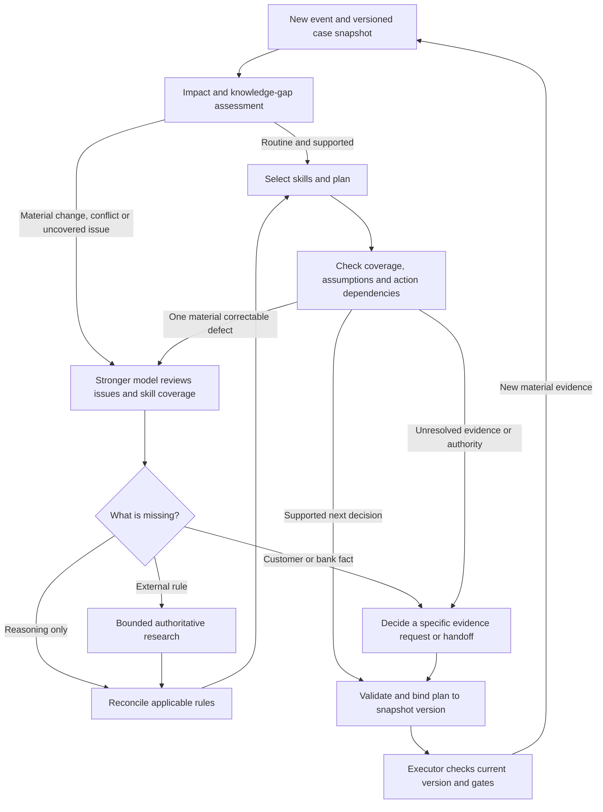

# Complex-case decision mode — proposed, not implemented

Preserve the public `context text -> decided Plan` contract. The orchestrator may spend more effort internally; the executor still receives concrete next actions and public grounds, never an instruction to invent a strategy. Existing `CaseRuntime`, model pool, cumulative budget and journal remain the execution foundation. Do not add a second untracked API client.



## Trigger stronger reasoning by the problem, not a magic word

Route on explicit reviewable reasons: a new event invalidates a premise of a pending action; irreversible or external action with conflicting evidence; multiple applicable domains impose incompatible requirements; a material issue has no catalog coverage; policy jurisdiction/date is unknown; or a semantic check identifies a consequential unsupported decision. The router should cite the input evidence and missing issue. Model self-confidence alone is not a reliable gate.

Do not route every mention of fire, death, fraud, a large amount or an unfamiliar name. A historic resolved event may be irrelevant; a quiet revocation can matter greatly. Keep a negative-control sample of routine cases and audit missed routing separately. Immediate safety support must not wait for a research loop.

Existing configuration can assign a stronger Planner model and select all skills globally. It cannot switch per case automatically. Start by comparing the same contexts with fixed standard/stronger profiles before implementing a router: if the stronger profile does not fix the residual error, automatic routing will not fix it either. Choose the stronger profile from measured performance and supported provider settings, not the model's marketing label. The saved public run used low reasoning effort; increasing effort is a separate experimental variable from changing the model.

## Compose relevant rules, do not enumerate every subset

Eleven skills already yield 2,048 subsets including the empty set. Enumerating them creates contradictory candidate plans and correlated votes, not a correctness proof.

1. Build a short issue list from the snapshot: active goal, changed premises, authority, affected operation, evidence gaps and relevant domains.
2. Review the **whole catalog** against those issues. The current selector already sees every catalog description; the new capability is to report uncovered issues and reconsider selection once a gap is discovered.
3. Load the applicable bodies and summarize obligations/conflicts with their applicability conditions. Selection is not a command to execute every skill's procedure. Do not silently discard a seventh essential issue because the current schema caps selection at six; report the coverage gap and test bounded staged loading or a revised cap explicitly.
4. Resolve compatible operations and name the exact unresolved conflict. Binding applicable restrictions constrain a procedure; a past plan or historical outcome does not override them. Uncertain legal applicability requires qualified review, not an invented precedence rule.
5. Generate one final next-action plan. Use a bounded critique only for concrete omissions, unsupported premises or unsafe dependencies. A critic must identify evidence and a corrective constraint; it must not fabricate a more elaborate answer just to appear useful.

Do not add a separate model for every skill. Measure whether one coverage pass and one critique materially improve results before considering parallel specialists.

## Research is evidence acquisition, not more thinking

Keep Planner tool-free by having an optional orchestration/context-enrichment component fetch a knowledge pack, then call Planner with that pack. The pack is part of the new declared input snapshot; identical text without the pack and enriched text are different experimental inputs.

For each research request record the unresolved question, relevant jurisdiction/product/event date, authoritative sources consulted, publication/effective/retrieval dates, short supported rule, applicability limits and unresolved conflicts. Prefer bank procedure for its own operations and authoritative applicable law/regulation for legal constraints. A public website cannot prove account identity, coverage, a payment result, consent or authority.

Search generic legal/product questions without exporting customer identifiers, transcripts or account details. Treat retrieved content as untrusted evidence; never follow embedded instructions or load model-supplied paths. For historical cutoffs, exclude later case outcomes and do not retroactively apply changed rules. If reliable knowledge is unavailable, return the precise missing-rule request and responsible reviewer; do not manufacture a citation.

Proposed initial bounds for an experiment: one coverage reassessment, up to two research rounds of at most three distinct queries, one semantic critique/revision, and one restart for a materially changed snapshot. These are engineering starting points, not validated optimal budgets. All attempts share one case deadline, request/token accounting and model pool. Stop early once the next action is supported; record timeouts, unavailable models and unresolved gaps. More credits do not remove the need for a termination rule.

## A material event must invalidate execution, not only prose

In production, bind a plan to a context version/hash and the specific premises/operations it depends on. Before a consequential action, the executor checks whether relevant case state changed. A newer receipt revoking authority or invalidating site safety must prevent a stale queued command from executing. Use idempotency keys and reconciliation for repeated events and ambiguous acknowledgements.

Distinguish pending, in-flight and completed operations. Stopping our queue is not cancelling an external court order. A completed payment cannot be “prevented”; its next step may be a scoped recall/reconciliation procedure, subject to supported rules and authority. Interrupted operations need explicit receipts, and related deadlines must not silently expire while the model researches.

If no safe concrete next action can be established, a scoped handoff can be the right final decision: recipient, precise unresolved issue, evidence package, urgency grounded in facts, affected actions held and unaffected work allowed. Blanket escalation for every case is a failure, not a reliable solver.

## Candidate shared instruction (review text only)

> When new information materially changes an assumption behind the current procedure, reassess the affected next actions using the latest applicable evidence. Identify which previous facts remain valid, which are contradicted or superseded, and which operations are pending, in flight or completed. Do not continue an affected stale action merely because it was previously planned. Decide the narrow supported pause, evidence request, review or replacement action within the available authority; do not claim control over external or completed operations. Preserve unrelated work. Distinguish missing case facts from missing general rules and apply only relevant skill conditions. If a final outcome cannot yet be determined, decide the concrete next step that obtains the required fact or qualified decision without assuming its result.

This belongs to shared case reasoning, not a “lightning and mortgage” skill. It is deliberately outside runtime pending a measured candidate comparison.

## Evaluation design

[contrastive-cases.json](contrastive-cases.json) contains eight synthetic development pairs (16 cases). They are deliberately readable counterexamples, **not a blind holdout** and not sourced legal gold. Any supplied policy is fictional and clearly labeled. External legal claims are not required to judge these operational invariants.

```sh
uv run python analysis/planner-generalization/prepare_cases.py
```

This writes only context text under `analysis/artifacts/planner-generalization/cases/inputs/<id>/context.md`; reference invariants stay under a sibling `references/` folder. Give Winner the **inputs** directory only. The preparer pins hashes and checks that both members and criteria exist. It does not invoke Planner or judge and does not claim the cases passed.

Compare, one variable at a time: existing runtime; shared material-change rule; stronger fixed model/effort; coverage reassessment; bounded research on explicitly researchable cases; one semantic critique. Reuse public ordinary controls to measure unnecessary escalation, but do not use their withheld next events as research material. Measure execution success, action correctness, unsupported assertions, stale-action continuation, unnecessary handoffs, paired invariance/sensitivity, routing misses, latency and cost.

Create further **unseen families** after freezing a candidate: swap assets and mechanisms (vehicle theft, supplier insolvency, revoked mandate, restored service), vary names/amounts/paraphrases without changing the decision, change one legally or operationally meaningful fact to require a different decision, and insert irrelevant dramatic history. Hold out entire causal families, not random paraphrases. Have references reviewed separately and preserve unknown where evidence does not justify one answer.

No number of successful examples or repeated model votes guarantees an answer for arbitrary events. A defensible goal is a higher measured rate of supported concrete decisions, with explicit missing-evidence handling and protection against stale or unauthorized execution.
