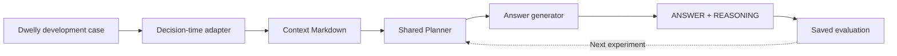
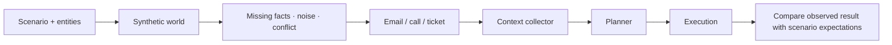

# Two loops, one Planner

[← Project](../../README.md) · [Data contract](../../dataset/README.md) · [Experiment commands](../../experiments/README.md)

We want to improve both **the decision made from known facts** and **the system's ability to gather and act on those facts**. They need separate tests.

## 1 · Optimize the decision core

The [Solver package](../../src/hackathon_winner/README.md) imports the same canonical Planner
as the model-backed product. It prepares evidence, obtains a structured decision and renders
the answer and reasoning, retaining the complete plan and execution traces of model calls.

The organizer's public examples contain completed histories. Our adapter chooses a decision point, retains evidence available then and excludes later events and outcome summaries. It creates the text input; the raw corpus is not universally one ready-made prompt file. The recorded ending is an example, not the only acceptable decision. [Organizer data guidance](https://github.com/DwellyOrg/HackatonPublicCases#using-the-examples).

The hackathon directly exercises the heart of our architecture: prepared evidence enters at
the Planner boundary, and the shared decision component produces the strategy used for
contest answers. Improving that component improves the product's decision-making core.

| Compare | Hold fixed | Inspect |
| --- | --- | --- |
| Planner variants | Context snapshots and answer generator | Decisions, evidence use, action arguments, escalation. |
| Answer generators | Saved plans and visible context | Faithfulness, clarity, unsupported claims. |
| End-to-end system | Scenario and initial state | Gathered context, action results, failure recovery. |

## 2 · Exercise the operating environment

**Implemented local banking world:** [Nikita's generator and runner](../../local_testing/banking/README.md) produce 1,180 cases with connected entity tables, separate incoming triggers and isolated evaluation material. The supplied entity tables describe completed cases, so the collector reads reviewed decision-time system responses and visible threads. Command-result templates are withheld. The design can extend across tracks; current adapters cover banking.

| Scenario variation | Question it should answer |
| --- | --- |
| Same name, different customer | Does collection preserve identity ambiguity? |
| Upload without a bank receipt | Does the plan avoid claiming confirmation? |
| Late attachment or future event | Is it absent from the earlier context? |
| Contradictory records | Are both sources preserved and uncertainty handled? |
| Failed handoff or ended call | Does execution stop without claiming success? |
| Duplicate incoming event | Is a previously recorded action replayed safely? |

Scenario expectations are reviewed alongside the evidence; model-generated expectations
remain hypotheses to assess rather than automatic ground truth.

## Evidence already available

[Current Winner evaluation](../../experiments/winner-public-decisions/README.md):
102 prepared decisions covering all 50 public banking scenarios, isolated
context/action files, Sonnet Planner and answer generation, and independent Opus
review. The rubric separates plan quality, output fidelity, factual grounding,
safety and reference ambiguity. Public examples remain development data.

[Historical MiniMax/Sonnet comparison](../../experiments/sonnet-vs-minimax-anthropic/README.md): 50 executed cases and 50 reviews per model on the earlier agent. Inputs and saved outputs are preserved. The judge's verdicts are assessments, not observed bank outcomes, and model/provider differences limit cost and latency comparisons.

Offline checks cover context boundaries, action routing, arithmetic, model-tool interaction
and durable replay. Saved model runs provide the separate evidence for decision review.

## Final challenge run

All **30 released banking challenges** completed the shared Planner → Winner path using
**Opus 5.5 high**. The submitted outputs preserve the exact context, plan, answer, reasoning
and local model journal for each case. Zero terminal errors measures run completion;
decision quality can be reviewed against the supplied evidence.

[Final answers](../../ANSWERS/README.md) ·
[Configuration and reproduction](../../experiments/final-challenges/README.md) ·
[Source hashes and provenance](../../ANSWERS/submission-manifest.json).

The development loop combines versioned [Planner skills](../../src/dwelly_bot/planner/skills/README.md),
prepared decision-time contexts, independent review and preserved comparison runs.
Further experiments can extend temporal snapshots and measure quality on held-out scenarios.

Use the existing experiment workflow and shared model/budget/journal infrastructure. Keep unseen Reality Test inputs out of tuning. Never replace failed captured answers with hand-written corrections.
