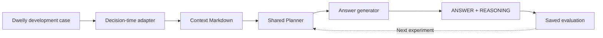
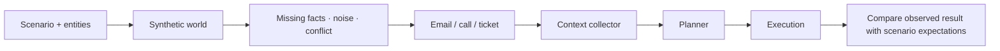

# Two loops, one Planner

[← Project](../../README.md) · [Data contract](../../dataset/README.md) · [Experiment commands](../../experiments/README.md)

We want to improve both **the decision made from known facts** and **the system's ability to gather and act on those facts**. They need separate tests.

## 1 · Optimize the decision core

The diagram is the target shared-core path. The [Solver package](../../src/hackathon_winner/README.md) now has generation/export and development predictions; aligning the advisory case Planner with the shared executable-plan contract is pending.

The organizer's public examples contain completed histories. Our adapter chooses a decision point, retains evidence available then and excludes later events and outcome summaries. It creates the text input; the raw corpus is not universally one ready-made prompt file. The recorded ending is an example, not the only acceptable decision. [Organizer data guidance](https://github.com/DwellyOrg/HackatonPublicCases#using-the-examples).

The hackathon fits our architecture because prepared evidence can enter directly at the Planner boundary. The same production decision component is intended to generate the plan used for contest answers.

| Compare | Hold fixed | Inspect |
| --- | --- | --- |
| Planner variants | Context snapshots and answer generator | Decisions, evidence use, action arguments, escalation. |
| Answer generators | Saved plans and visible context | Faithfulness, clarity, unsupported claims. |
| End-to-end system | Scenario and initial state | Gathered context, action results, failure recovery. |

## 2 · Exercise the operating environment

**Implemented local banking world:** [Nikita's generator and runner](../../local_testing/banking/README.md) produce 1,180 cases with connected entity tables, separate incoming triggers and isolated evaluation material. The supplied entity tables describe completed cases, so the collector reads reviewed decision-time system responses and visible threads. Command-result templates are withheld. The design can extend across tracks; current adapters cover banking.

| Scenario variation | Question it should answer |
| --- | --- |
| Same name, different customer | Does collection preserve identity ambiguity? |
| Upload without a bank receipt | Does the plan avoid claiming confirmation? |
| Late attachment or future event | Is it absent from the earlier context? |
| Contradictory records | Are both sources preserved and uncertainty handled? |
| Failed handoff or ended call | Does execution stop without claiming success? |
| Duplicate incoming event | Is a previously recorded action replayed safely? |

Scenario-writing, simulated-customer and review sub-agents are possible supporting roles. A generated expectation is still a hypothesis to inspect, not ground truth merely because another model wrote it.

## Evidence already available

[Historical MiniMax/Sonnet comparison](../../experiments/sonnet-vs-minimax-anthropic/README.md): 50 executed cases and 50 reviews per model on the earlier agent. Inputs and saved outputs are preserved. The judge's verdicts are assessments, not observed bank outcomes, and model/provider differences limit cost and latency comparisons.

The current skeleton has offline checks for context boundaries, action routing, arithmetic, model-tool interaction with a local test model, and durable mock replay. These establish mechanics; they do not establish final Planner quality.

## TODO · final optimization story

- [x] Integrate the supplied generator, schema, seed selection and case triggers.
- [ ] Extend the generator with temporal entity snapshots and explicit read/action response types.
- [ ] Vera: link the final Planner and versioned skills/configuration.
- [x] Link [Solver generation/export](../../src/hackathon_winner/README.md).
- [ ] Align context preparation and Planner contracts across local and contest paths.
- [ ] Evaluation owner: add the new same-input baseline/candidate table and representative failures.
- [ ] Team: document the final held-out split and immutable run receipts.

Use the existing experiment workflow and shared model/budget/journal infrastructure. Keep unseen Reality Test inputs out of tuning. Never replace failed captured answers with hand-written corrections.
