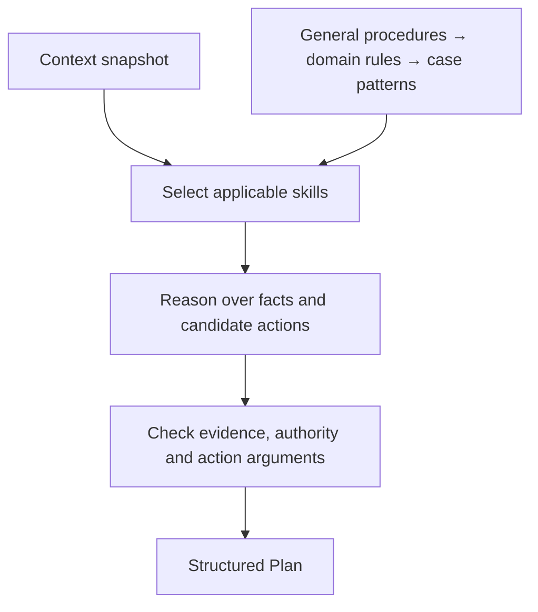

# The decision core

[← Project](../../README.md) · [Implementation handoff](../../src/dwelly_bot/planning/implementation/README.md) · [Action catalogue](../../src/dwelly_bot/planning/README.md)

**Prepared context in. A concrete decision and action sequence out.**

The Planner owns the intellectual part of handling a case: interpreting facts, applying knowledge, resolving competing options and choosing when to act, clarify or escalate. It assumes the context collector has already gathered available evidence. It does not query customer databases or perform operational actions.

## Contract that stays small

```python
from dwelly_bot.planning import Plan, Planner

# `planner` is an implementation configured with a model, knowledge and action profile.
async def decide(planner: Planner, context_markdown: str) -> Plan:
    return await planner.plan(context_markdown)
```

A plan records `decision`, `disposition`, ordered `actions` and a short public `rationale`. Each action has concrete arguments. Immediate escalation can be the whole decision; more steps are not automatically better.

| Decision | Example output |
| --- | --- |
| Respond | Reply to the original channel using the established facts. |
| Act | Calculate from supplied values, then report the result. |
| Clarify | Ask a specific question and wait for new information. |
| Escalate | Name the receiving team and provide the reason for handoff. |

[Production and contest profiles](../../src/dwelly_bot/planning/catalog.py) configure the permitted vocabulary. Production currently uses mock execution; contest actions remain proposals for the answer generator.

## Proposed internal architecture

This is a design sketch for Vera, **not a description of the current stub**.



A multi-step implementation can separate skill selection, candidate generation and review. Specialist sub-agents could help with narrow questions if experiments demonstrate a benefit. All stages must share the same decision-time evidence; an extra agent must not introduce later outcomes or unobserved customer facts.

The model, routing, skill hierarchy and number of passes are deliberately open. The external API and action contract let the team change those choices without rebuilding channels or the context collector.

## Final implementation slots

| Owner | Replace this placeholder with |
| --- | --- |
| Vera | Exact model/provider/version and configuration link. |
| Vera | Skill tree, selection mechanism and one concrete example. |
| Vera | Implemented reasoning stages and any specialist-agent responsibilities. |
| Vera | Stopping behavior for missing context, conflict and insufficient authority. |
| Vera + evaluation | New baseline, candidate comparison and inspected failures. |

**Current code:** `HumanReviewPlanner` always emits human review and an acknowledgement. It demonstrates the boundary, not banking reasoning quality. Implement the final component in [planning/implementation/](../../src/dwelly_bot/planning/implementation/README.md); update this page when the design becomes code.

## Concurrent team implementation

The team has added an [advisory case Planner](../../src/dwelly_bot/planner/README.md) and
[Solver package](../../src/hackathon_winner/README.md). That Planner currently accepts
`PlanInput` and emits its own advisory schema. The local runner continues to use the shared
`planning.Planner` protocol and human-review stub. A deliberate adapter/alignment step is
needed before substituting it for executable plans; its advice is not silently executed.

The advisory Planner now selects [modular runtime skills](../../src/dwelly_bot/planner/skills/README.md) with a structured model call before planning. Common evidence and triage modules remain always loaded; selected skills and hashes are journalled. This does not change the local executable-plan stub or its contract.
