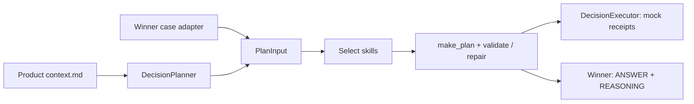

# One decision core

[← Project](../../README.md) · [Implementation](../../src/dwelly_bot/planner/README.md) · [Skills](../../src/dwelly_bot/planner/skills/README.md)

**Prepared context in. Decided next actions with public grounds out.**
The Planner interprets evidence, selects relevant skills and chooses what happens next.
It has no customer-data tools and performs no banking operation.



## Product API

```python
from pathlib import Path
from dwelly_bot.planner.service import DecisionPlanner

# event is trusted normalized intake; config is a loaded RunConfig.
planner = DecisionPlanner(event, config, Path(".cache/run/planner.jsonl"))
plan = await planner.plan(context_markdown)
```

The adapter supplies the request, scope, time and exact `context.md` to the existing
`make_plan` implementation. Winner uses `make_plan` directly with its case adapter.
Both return `dwelly_bot.planner.Plan`, retaining every fact, ground and dependency.
Neither converts a decision into the older six-action fixture format.

## Returned decision

| Field | Purpose |
| --- | --- |
| `summary` | The decision taken now. |
| `facts`, `missing` | Established evidence and unresolved information. |
| `identity_authority`, `safety_flags` | Known authority and applicable handling constraints. |
| `steps` | Ordered actions with target, instruction, arguments and prior-step dependencies. |
| `steps[].rationale` | Explanation, evidence IDs, handling criterion and loaded rule source. |
| `must_state`, `must_not` | Constraints on the eventual response. |
| `expected_disposition` | Expected outcome, not proof of execution. |

The allowed banking vocabulary is in `planner/playbooks/banking.json`.
Missing essential evidence leads to a concrete question or handoff now; a later answer
triggers a fresh decision. New plans cannot defer business decisions into free-form
conditions. Grounds must cite actual evidence and loaded rules. Model repair uses
configured limits; failure remains visible rather than silently fabricating a plan.

## Configuration and ownership

Vera's model implementation, prompts and knowledge live in `src/dwelly_bot/planner/`.
General evidence/safety rules always load; a structured selection call chooses allowlisted
skills. `RunConfig.planner` controls the model, playbook, selection mode and repairs.
The same pool, budget ledger and journal mechanisms account for model calls.
[Winner configuration](../../src/hackathon_winner/config.json) is usable by the product
with `--planner-config`.

The offline default remains `planning.HumanReviewPlanner`, an explicit fixture.
`planning/` preserves existing demo profiles and captures; it is not a second model
implementation. Specialist sub-agents and automatic stronger-model routing are not implemented.

## Evidence and boundaries

[Integration verification](../../experiments/usability-integration/README.md) covers the
shared product path, Winner and HTTP session service. It does not establish corpus-wide
banking quality. The old agent baseline is stale and has not been replaced.
Model/skill changes still need controlled comparison through the experiment workflow.
Natural-language correctness and faithful rendering need evaluation beyond schema checks.
