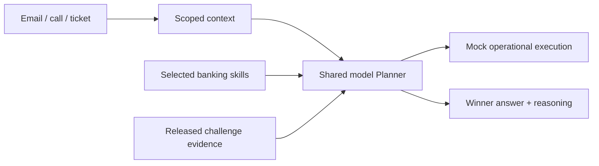

# Project story

[← Project](../README.md) · [Product demo](../demo/README.md) · [Live voice runbook](../demo/LIVE-DEMO.md)

## The problem

A customer says a payment was sent; a record shows a debit; the recipient reports no money.
A useful service agent must separate established facts, conflicting evidence and missing
information before choosing a concrete next action.

## Our approach

Context collection and decision-making are separate components. The Planner selects relevant
skills, applies them to supplied facts and produces a structured decision with explicit actions
and evidence-linked grounds. Product model mode and Hackathon Winner import this same component.
A missing material fact can lead to a concrete question or human handoff.

## What we can show

| Evidence | What it establishes | Boundary |
| --- | --- | --- |
| [30 final challenge outputs](../ANSWERS/README.md) | Opus 5.5 high completed the Planner → answer/reasoning path for every banking case. | No independent correctness score; all bank actions are proposals. |
| [Synthetic banking world](../local_testing/banking/README.md) | Separate state, incoming cases and evaluator material; scoped context and local pipeline. | Prepared decision-time snapshots, not a live bank database. |
| [Recorded product demo](../demo/dashboard.mp4) | Case desk and review workflow over earlier development results. | Dashboard metrics are not final challenge scores. |
| [Voice demo](../demo/voice-call.mp4) | ElevenLabs conversation connected to the local tool/pipeline. | Prepared fixture plan; no live model decision or real operator transfer. |

## Next steps

Measure decision quality on held-out cases, connect authorized real action adapters, and
connect canonical model plans to the live speech path. Today, explicit mock receipts and
preserved inputs make the boundary visible. After the hackathon freeze, implementation,
prompts, plans and generated results remain unchanged; these pages document existing behavior.
