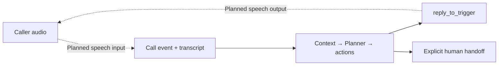

# Voice as another channel

[← Project](../../README.md) · [Call fixture](../../examples/production/call.json)

A caller should reach the same decision core as an email or ticket. Speech handles the conversation; the shared Planner owns the operational decision.

**Implemented:** a call-event contract with session ID and active state, a mock `speak_in_call` result, and a distinct `call_customer` action for a new outbound call. An inactive call does not silently turn into a callback.

**Pending:** microphone/telephony transport, speech recognition, generated audio, turn-taking and live session updates. The current call demo contains text; it is not a voice-agent demo.

## Fill when the integration is selected

| Field | Final value |
| --- | --- |
| Provider and documentation | **TODO** — ElevenLabs is a candidate, not an adopted dependency. |
| Speech / conversational model IDs | **TODO** — exact version(s). |
| Voice and language configuration | **TODO** — selected voice and supported languages. |
| Credentials and setup | **TODO** — environment-variable names and provisioning instructions. |
| Transport / integration code | **TODO** — link the implemented adapter. |
| Audio example / demo timestamp | **TODO** — link only after a real recording exists. |
| Measured behavior | **TODO** — latency, interruption and disconnect observations. |

Integration checks should cover a normal answer, a clarification, caller interruption, disconnect and human transfer. A speech outage should not prevent non-voice cases from running. Recording and retention need explicit setup; no session capture is enabled by this repository.

Reference to investigate: [ElevenLabs agent documentation](https://elevenlabs.io/docs/eleven-agents/overview). This page reserves the integration boundary; it does not claim a provider decision or completed feasibility test.
