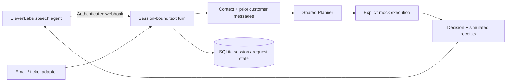

# Voice and authenticated service intake

[Project](../../README.md) · [Implementation](../../src/dwelly_bot/service/) · [Integration evidence](../../experiments/usability-integration/README.md)

The optional FastAPI service connects text turns from ElevenLabs webhook tools or another
trusted channel adapter to the same context collector and Planner used by the local bot.
ElevenLabs owns speech and turn-taking; the backend owns the banking decision. The service
runs locally without an ElevenLabs account. A managed audio conversation additionally needs
an ElevenLabs agent and an HTTPS route to the running service.



## Local setup

```sh
uv sync --locked --extra server
# Provision from trusted local input, never from an unauthenticated request body.
uv run dwelly-bot service bind --input examples/production/call.json

# In another terminal; no model key required for the explicit human-review demo.
uv run dwelly-bot service serve --records examples/production/records.json
```

`bind` prints a random session ID, a bearer token and its TTL (default one hour, maximum
one day). Treat the token as a credential. The SQLite store keeps its hash, not the token.
The default state is `.cache/service/sessions.sqlite`; pass `--state PATH` **before**
`bind` or `serve` when using another store. The caller's name/number remains an identity
hint, even though the transport is authenticated.

```sh
# Set these from the bind result in your local shell; do not commit them.
export DWELLY_SESSION_ID='session-id-from-bind'
export DWELLY_SESSION_TOKEN='token-from-bind'

curl --fail-with-body http://127.0.0.1:8780/sessions/$DWELLY_SESSION_ID/turns \
  -H "Authorization: Bearer $DWELLY_SESSION_TOKEN" \
  -H 'Content-Type: application/json' \
  -d '{"request_id":"turn-001","text":"Please check the payment status."}'

curl --fail-with-body -X POST \
  http://127.0.0.1:8780/sessions/$DWELLY_SESSION_ID/close \
  -H "Authorization: Bearer $DWELLY_SESSION_TOKEN"
```

A turn accepts only `request_id` and `text`. The trusted binding determines the case scope,
caller, channel and reply route; server time determines receipt time. Email and ticket input
fixtures can be bound in exactly the same way. `/health`, `/turn-schema` and `/openapi.json`
expose no case data. Extra JSON fields and oversized bodies are rejected.

## Model-backed service and synthetic bank

```sh
uv run dwelly-bot service serve \
  --dataset local_testing/banking/data/seed-2026 \
  --planner-config src/hackathon_winner/config.json \
  --context-config experiments/synthetic-context-integration/config.json \
  --timeout 45
```

Before starting, bind a trusted case file from that dataset, for example
`local_testing/banking/data/seed-2026/cases/SYN-0001.json`; its existing email/call/ticket route
is preserved. To make a **local transport replay** as a call, use `local_event(dataset, case,
"call")` from `dwelly_bot.local_cli` to save a trusted CallInput and bind that JSON. This is
not a real authentication check or a migration of a real customer's communication consent.
The service verifies the prepared dataset manifest before using its read-only sources.

`--planner-config` selects the actual shared case Planner; omit it for the offline stub.
`--context-config` selects the optional model-directed collector; omit it for deterministic
source reads. Model keys come from `.env` / environment as in ordinary Winner runs. Provider
pools, budgets and local traces are reused. The service's timeout bounds the whole request;
choose a provider tool timeout slightly longer so the backend can return its explicit error.
Model latency and call interruption have not been measured with a live ElevenLabs session.

## ElevenLabs webhook tool

Verified against [webhook-tool documentation](https://elevenlabs.io/docs/eleven-agents/customization/tools/webhook-tools)
and [dynamic variables](https://elevenlabs.io/docs/eleven-agents/customization/personalization/dynamic-variables)
on 2026-10-10. Webhook tools support HTTP endpoints and secret-backed authorization headers.
Secret dynamic variables can keep per-session credentials out of model prompts.

Configure a webhook tool in the managed agent:

| Setting | Value |
| --- | --- |
| Name | `handle_banking_turn` |
| Method | `POST` |
| URL | Your HTTPS backend `/sessions/{trusted_session_id}/turns` |
| Authorization | `Bearer <session token>` from a secret header / secret dynamic variable |
| JSON body | `request_id`: stable unique ID for this turn; `text`: customer's current relevant request |
| Schema | The backend's `/turn-schema` response |
| Timeout | Longer than the backend's `--timeout`; keep within the provider's supported settings |

Bind the session ID through trusted configuration, not customer conversation. Reuse the same
request ID and body for a transport retry; use a new ID for a new turn. A provider/tool model
that changes IDs on retry loses request-level deduplication, so test that integration behavior.
Banking effects remain mock and are never made real merely by attaching a voice provider.

Suggested speech-layer instruction:

> Use handle_banking_turn for each operational banking request. Convey the returned decision,
> requested clarification and constraints faithfully; do not choose a different banking strategy.
> The result explicitly identifies simulated operations. Never say a transfer, handoff, email,
> update or other bank action occurred because it appears in a plan. On a processing failure,
> explain that no completion was confirmed. Do not request passwords, PINs or one-time codes.

Send an authenticated close request from your trusted conversation lifecycle handler when
the call disconnects. Do not treat this route as an ElevenLabs post-call webhook: that event
has a different payload and signature contract. Without a lifecycle close request, the session
expires at its TTL; the backend cannot infer a remote microphone disconnect.

The backend does not create or reconfigure vendor agents, select a voice automatically,
start calls, enable provider recording or upload a dataset. Use the managed provider's voice,
language and deployment settings for the actual account and record those choices with a live
verification receipt. There is no fabricated voice ID or claimed audio demo in this repository.

## Storage and failure behavior

SQLite serializes claims across processes. Exactly one turn per session runs at a time.
A completed request replays its stored result after process restart. Changed input under the
same request ID returns 409; another in-flight turn also returns 409. A closed session rejects
new work. A request interrupted by process death becomes an explicit timeout after its lease;
it is not silently re-executed. A failed request remains failed on replay.

Local captures preserve input, normalized trigger, context, the complete plan, execution
receipts and model traces. The session store retains input messages and request results;
only the last 20 completed customer requests are added to subsequent context, with an explicit
window warning. Generated plans are not fed back as verified bank state. Original case input
is retained as a prior assertion. No audio is stored and no vendor telemetry is enabled.
These local artifacts can contain sensitive text; deployment owners must configure retention
and access to the private state/capture directory. The server disables access logs by default.

All external actions currently return `execution: mock` / `external_effects: false`.
Real banking, email, ticket or telephone effects require provider-specific authenticated
executors and receipt reconciliation. This service does not claim those integrations exist.
