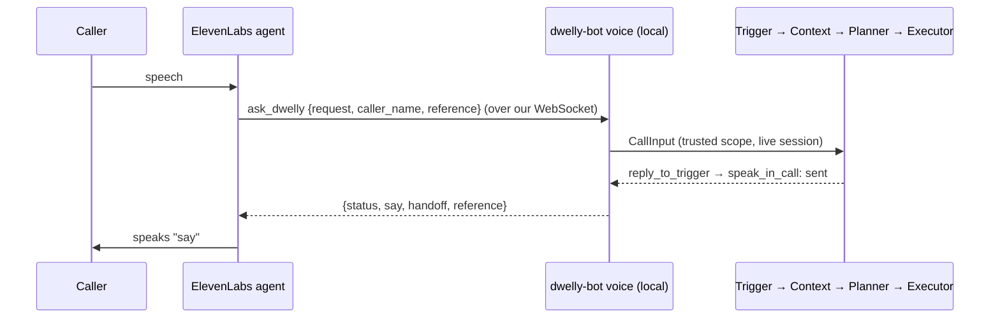

# Voice demo: ElevenLabs agent → Dwelly call pipeline

[← Voice channel](../../docs/voice/README.md)

A caller talks to an ElevenLabs voice agent. When the agent needs the bank's answer it calls the
client tool `ask_dwelly`. Our local process receives that call over the WebSocket it opened to
ElevenLabs, runs the normal call pipeline and returns the reply that the executor queued for the
call. The agent speaks it. No hosting, tunnel or public URL is involved.



## 1. Create the agent in ElevenLabs (once)

1. **Agents → Create agent → Blank agent.** Name: `Dwelly front desk`.
2. **Voice:** a calm British voice from the library. **Language:** English.
   **LLM:** any fast built-in model; it only runs the conversation.
3. **First message:**
   `Hello, you're through to Harrow and Vale. I'm Dwelly's virtual assistant. Please don't share your PIN or passwords with me. How can I help?`
4. **System prompt:**

   ```text
   You are the friendly front desk of Harrow & Vale Bank, powered by Dwelly.
   You do not know any account information and you never decide anything yourself.

   1. Listen. Ask for the caller's name and what the request is about (payee, amount,
      date, reference). Briefly confirm the details back.
   2. Say: "Thank you, let me check this with the Dwelly investigations team, one moment."
      Then call the tool ask_dwelly once with a clear one- or two-sentence summary.
   3. When the tool returns:
      - status "answered": tell the caller the content of "say" in natural words. Do not add
        facts, promises, amounts or dates that are not in "say".
      - status "no_answer" or "failed": apologise, say you could not get an answer right now
        and that they can call again or use secure messages. Do not invent an answer.
   4. Never ask for or repeat PINs, passwords, one-time codes or full card numbers.
      Never agree to move money or change anything during the call.
   5. Offer further help; when the caller is done, say goodbye and end the call.
   ```

5. **Tools → Add tool → Client tool**
   - Name: `ask_dwelly` (exact spelling)
   - Description: `Send the caller's request to Dwelly's case system and get the bank's answer to read back.`
   - **Wait for response: on**
   - Parameters:

     | Name | Type | Required | Description |
     | --- | --- | --- | --- |
     | `request` | string | yes | One or two sentences summarising what the caller wants, with any amounts, payees and dates they said. |
     | `caller_name` | string | no | Name the caller gave. |
     | `reference` | string | no | A reference or transaction number the caller gave, if any. |

6. **Tools → system tools:** enable **End call**.
7. **Security:** turn on **authentication** (private agent). **Privacy:** set the shortest
   conversation retention your plan allows; this repository does not enable session capture.
8. **Publish.** Copy the agent ID.

Create an API key on the ElevenLabs **API keys** page (conversation access to Agents is enough). Put both values in the ignored `.env`:

```sh
ELEVENLABS_API_KEY=...
ELEVENLABS_AGENT_ID=...
```

## 2. Run

```sh
uv sync --extra voice

# Offline: the same bridge and pipeline, no ElevenLabs, no microphone.
uv run dwelly-bot voice ask --scope voice-demo-transfer --records examples/voice/records.json \
  --plan examples/voice/plan.json --output .cache/voice/ask-1 \
  --request "Has my 350 pound transfer to Kestrel Joinery arrived?"

# Live, typed: talks to the real agent without audio.
uv run dwelly-bot voice call --text --scope voice-demo-transfer --records examples/voice/records.json \
  --plan examples/voice/plan.json --output .cache/voice/text-1

# Live, microphone and speakers.
uv run dwelly-bot voice call --scope voice-demo-transfer --records examples/voice/records.json \
  --plan examples/voice/plan.json --output .cache/voice/call-1
```

`--plan` replays the prepared demo plan. Without it the placeholder planner always hands off to a
person and says so. When the real planner is available, `voice` uses the same `Planner` contract.
`--context-config` enables the paid context investigator, `--sqlite` reads a normalized database.

Each tool call writes a normal pipeline capture under `--output/<session>-<n>/`
(`trigger.json`, `context.md`, `plan.json`, `result.json`, `events.jsonl`). `session.json` links the
local session to the ElevenLabs conversation ID. Transcripts are printed, not saved.

## Demo script (~60 s)

Caller: "Hi, I'm Jamie Rowe. I sent 350 pounds to Kestrel Joinery on Wednesday and they say they
haven't got it. Has it gone?" The agent confirms the details, says it is checking with the Dwelly
investigations team, and the capture folder appears. It then answers: sent, not yet confirmed as
received, an investigator will trace it, please don't pay again. Show `result.json`: the handoff
is `simulated` and the spoken reply is `sent` to the live session.

## Behaviour and limits

- The scope (`--scope`) and caller ID come from local configuration, never from what the caller
  says. Names and references are search hints only.
- Only `reply_to_trigger` on the open session is live. Handoffs, emails, tickets and outbound
  calls stay mock. If the caller has hung up, the reply fails; it never becomes a callback.
- One request runs at a time per session; a failed pipeline returns `failed` with nothing to say.
- Phone numbers (Twilio/SIP) need server-side webhook tools and a public URL; not part of this demo.
- `ask_dwelly` runs the whole pipeline while the caller waits. Turn on tool call sounds if the
  planner becomes slow.
