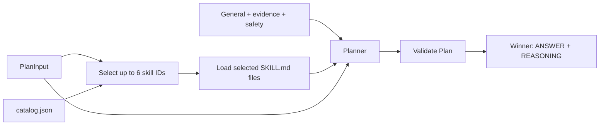

# Planner knowledge

Small, versioned runtime skills. The selector sees only the catalog and the supplied case;
the Planner then receives the chosen bodies plus the always-on general/evidence/safety rules.
No browser, database, filesystem tool or specialist sub-agent is added.

| Skill | Main boundary |
| --- | --- |
| [Payments](payments/SKILL.md) | Sent versus received; return requested versus returned |
| [Scheduled payments](scheduled-payments/SKILL.md) | Instruction versus collection; cancellation versus refund |
| [Cards and access](cards-access/SKILL.md) | Identity, recovery, sensitive changes and recorded state |
| [Business authority](business-authority/SKILL.md) | Mandates, file/batch/line status and dual approval |
| [Fraud and takeover](fraud-takeover/SKILL.md) | Stop risky actions, escalate, avoid recovery promises |
| [Financial abuse](financial-abuse/SKILL.md) | Safe contact and disclosure, individual control |
| [Vulnerability support](vulnerability-support/SKILL.md) | Adjustments, hardship, human access and debt protections |
| [Bereavement and authority](bereavement-authority/SKILL.md) | Death notification versus estate authority |
| [Crisis support](crisis-support/SKILL.md) | Immediate safety, including indirect disclosures |
| [Complaints and rights](complaints-rights/SKILL.md) | Complaint registration versus a decided remedy |
| [Privacy and documents](privacy-documents/SKILL.md) | Recognise a request without authorising disclosure |

## Sources and applicability

Each skill separates project handling rules from short original summaries of external
principles. [sources.json](sources.json) records official URLs, scope and review date;
links also live in each skill. Reviewed **2026-10-10**. No external code or case answers
are copied into runtime knowledge. Skills are UK-oriented: do not assume that a current
rule applied to an earlier event, a different payment scheme or a different jurisdiction.
No universal deadlines, reimbursement amounts or bank-specific channels are embedded.

Useful external material exists at different levels: the official Open Banking repository
covers API schemas, whereas FCA, PSR, Financial Ombudsman, ICO, UK Finance, Pay.UK, NHS and
GOV.UK cover specific handling principles. None is used as a complete bank operating manual.

## Editing a skill

1. Update its concise `SKILL.md`: when applicable, next actions, evidence distinctions,
   boundaries and sources. Keep the frontmatter description aligned with `catalog.json`.
2. Add/update its catalog entry and source records. IDs are local allowlisted names;
   model-selected paths or URLs are never opened.
3. Add representative and negative-control tests; use the experiment workflow for
   behaviour changes. The lexical source inventory is not a routing algorithm or an evaluator.
4. Inspect selected IDs, resource hashes, prompts and actual plans in saved journals.
   A skill can be relevant without every rule in it applying. Selection is not a risk verdict.

The current selection uses the configured Planner model, sharing its account, cumulative
request/token limits and captures. It normally adds one call. Invalid IDs/duplicates/oversized
selections use the existing repair limit. A failure remains a visible Planner error; there
is no silent fallback or budget reset. `planner.skill_selection: "all"` preloads all eleven
skills without selection for controlled ablations/troubleshooting. It is not the default.
An empty selection still receives all general evidence and safety rules.
