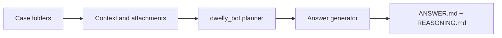

# Hackathon Winner

A folder of supplied cases → [Vera's Planner](../dwelly_bot/planner/README.md) → answer generator → a folder of results. The module sits beside `dwelly_bot` in `src/` and imports its public Planner API. Bank operations are proposed, never executed.



## Run

From the repository root:

```sh
uv sync --extra evaluation

# Final folder layout; output defaults to repository-root ANSWERS/.
uv run hackathon-winner /path/to/cases

# Evaluation run into a separate directory.
uv run hackathon-winner /path/to/cases --output .cache/winner/evaluation-1

# No arguments: bundled two-case smoke dataset, repository-root ANSWERS/.
uv run hackathon-winner
```

The default [config](config.json) uses the project's configured Anthropic API with `claude-sonnet-5-5`. Set `ANTHROPIC_API_KEY` in your environment or repository `.env`; the shared account ledger records costs. No credentials belong in configuration or outputs. Use `--config PATH` for any supported `RunConfig`. Vera's Claude Code transport remains available with `--config src/hackathon_winner/config-claude-code.json`; it requires an installed CLI and valid signed-in session, and records API-equivalent usage. The evaluation extra enables PDF text extraction.

`--ids 001,002` selects folders. `--template` replaces only the answer generator with deterministic rendering; Planner still calls its model. `python -m hackathon_winner` works too. `hackathon-solver` and the `predict --cases PATH` syntax remain command aliases.

Existing outputs are never overwritten; choose a fresh evaluation directory for each run. No submission flag is required to create the final folder layout. Generating files does not upload them or establish that the inputs are official Reality Test cases. The bundled samples and public practice histories remain development data even when written to `ANSWERS/`.

## Input and output

```text
cases/                              ANSWERS/
├── 001/                            ├── 001/
│   ├── history.md                  │   ├── ANSWER.md
│   └── attachments/               │   ├── REASONING.md
└── 002/                            │   ├── context.md
    └── context.md                  │   ├── plan.json
                                    │   └── generation.json
                                    ├── 002/...
                                    ├── predictions.json
                                    ├── journals/...
                                    └── report.html
```

- Each direct child folder is one case. Its name becomes the output folder name, preserving leading zeroes and organizer identifiers.
- The primary text is `history.md`, then `context.md`, then `request.md`. A separate `request.md` is included if supplied alongside history/context. Dwelly event Markdown is parsed into event IDs; an unfamiliar text format remains a complete document.
- TXT, Markdown, CSV and JSON attachments retain their text. PDF text is extracted when available. Unsupported images, scanned PDFs and failed PDF reads are explicit gaps; no OCR is claimed.
- `index.md`, expected answers and evaluator labels are not read. Inputs are hashed in `predictions.json`. This adapter uses all supplied history and attachments; prepare a decision-time snapshot before a blind evaluation. It does not infer a cutoff from filenames.
- The small [smoke dataset](data/README.md) is included with the module. The large generated banking world and organizer originals stay in their existing ignored locations; no corpus is duplicated into Git.

## Planner and reasoning

The actual Planner implementation remains in `src/dwelly_bot/planner/`, including its contracts, prompt and playbooks. Its public imports are:

```python
from dwelly_bot.planner import Plan, PlanInput, make_plan, plan_case
from hackathon_winner import run_cases

# async context; output can be any new directory
# await run_cases(Path("cases"), output=Path("evaluation/run-1"), config=config)
# plan = await make_plan(runtime, plan_input, planner_config)
```

Winner supplies all evidence through `PlanInput` and advertises no execution tools. The generator receives the resulting plan plus the same context. `ANSWER.md` gives the decision and proposed actions; `REASONING.md` is an operator-facing decision memo covering history, evidence references, gaps, why the chosen actions fit, conditional outcomes and limitations. It preserves the Planner's conditions and prohibitions instead of adding a second strategy. Reasoning is a public justification, not a private model transcript.

`context.md`, `plan.json` and `generation.json` make each output inspectable. Local journals retain model messages/configuration/costs, including errors. No execution stacktrace is fabricated: there is no bank executor on this path. A failed Planner or generator produces an explicit human-review notice, leaves later cases runnable and makes the command exit nonzero. Model wording can still be wrong; this plumbing is not a quality benchmark.

The product's `dwelly_bot.planning.Plan` executable-action contract is separate. Aligning it with the advisory Planner remains product integration work; Winner already imports and runs Vera's implementation directly.

## Saved-plan generation

```sh
uv run hackathon-winner generate --input DIR --output .cache/winner/render-1 --development
uv run hackathon-winner report --input .cache/winner/evaluation-1
```

`generate` accepts `<case>.plan.json` and `<case>.context.md` for the product action schema. Without `--config` it is an offline renderer; supplying config enables model wording. `report` rebuilds HTML from saved outputs without model calls.
